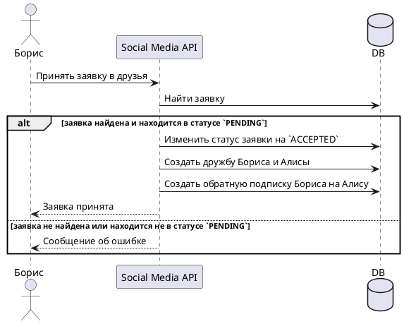

## Основной сценарий L1

1. Алиса отправляет заявку в друзья Борису.
2. Система создаёт заявку в статусе `PENDING`.
3. Система создаёт подписку Алисы на Бориса.
4. Борис принимает заявку в друзья.
5. Система изменяет статус заявки на `ACCEPTED`.
6. Система создаёт дружбу между Алисой и Борисом.
7. Система создаёт обратную подписку Бориса на Алису.

## Альтернативный сценарий: отклонение заявки
1. Борис отклоняет заявку в друзья.
2. Система изменяет статус заявки на `REJECTED`.
3. Система не создаёт дружбу между Алисой и Борисом.
4. Подписка Алисы на Бориса сохраняется.

## Диаграмма последовательности принятия заявки

## Таблица действий

| Действие                  | Инициатор | Предусловие                                                                                | Результат                                                                                           |
|---------------------------|---|--------------------------------------------------------------------------------------------|-----------------------------------------------------------------------------------------------------|
| Отправить заявку в друзья | Алиса | Оба пользователя существуют, они разные, активная заявка той же направленности отсутствует | Создана заявка в статусе `PENDING`, Алиса подписана на Бориса                                       |
| Принять заявку            | Борис | Заявка существует и находится в статусе `PENDING`, Борис — получатель заявки               | Заявка в статусе `ACCEPTED`, создана дружба Алисы и Бориса, создана обратная подписка Бориса на Алису |
| Отклонить заявку          | Борис | Заявка существует и находится в статусе `PENDING`, Борис — получатель заявки               | Заявка в статусе `REJECTED`, дружба не создаётся, подписка Алисы на Бориса сохраняется               |

## Инварианты

1. Нельзя отправить заявку самому себе.
2. Нельзя создать две активные заявки одной направленности.
3. Дружба не может существовать только для одной стороны.
4. Принятие заявки должно создавать дружбу и обратную подписку атомарно.
5. Отклонение заявки не отменяет подписку инициатора.
6. Повтор команды не должен создавать дублирующие связи.